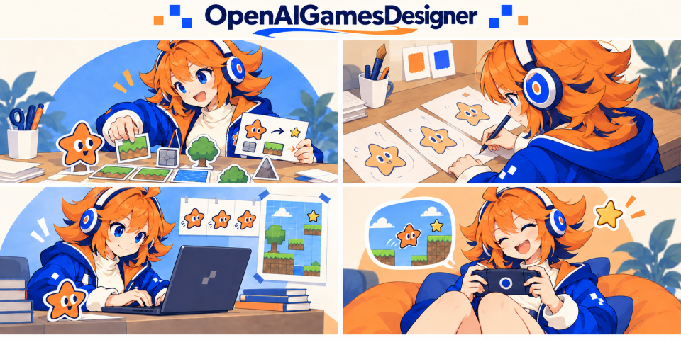
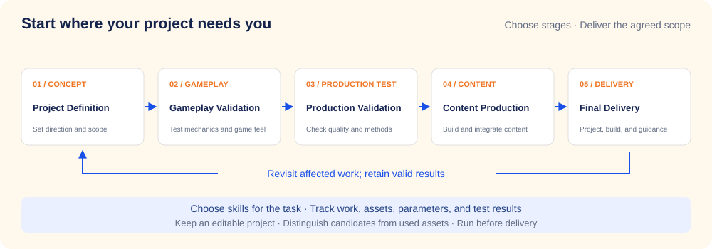
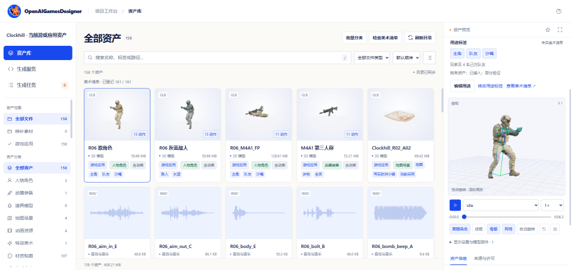
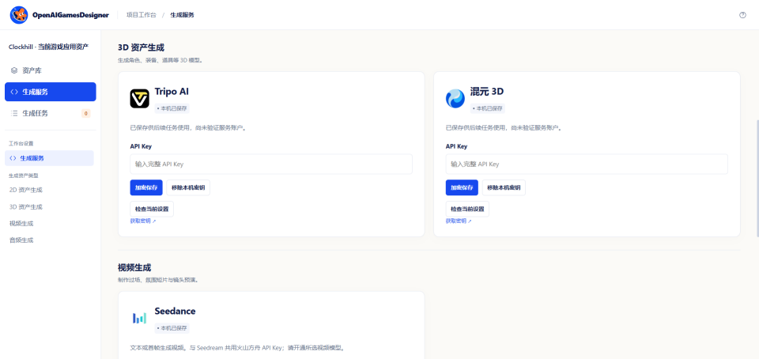

<div align="center">

# OpenAIGamesDesigner: AI Game Development Toolkit

[English](README.md) | [简体中文](README.zh-CN.md)

</div>

**OpenAIGamesDesigner helps AI agents and developers turn game ideas into playable projects.**

> **OpenAIGamesDesigner** includes **16 game development skills** covering design, art, animation, audio, programming, and testing, with **a five-stage workflow, asset discovery, asset tracking and version management, and a project workbench**. It provides project integration and runtime validation tools for **Godot, Unity, Unreal Engine, Three.js, and Phaser**, uses **Blender** for asset processing, and connects to external services for **image, 3D model, video, and audio generation**.

<div align="center">

**[Game Demos](#game-demos) · [Development Workflow](#development-workflow) · [Quick Start](#quick-start) · [Project Workbench](#project-workbench) · [Game Asset Collection](#game-asset-collection) · [Engines and Tools](#engines-and-tools) · [Project Files](#project-files)**

</div>

<br>

## Game Demos

Gameplay captured from projects built with the toolkit.

<table>
<tr>
<td width="50%" valign="top" align="center">
<h3>FPS Game</h3>
<video src="https://github.com/user-attachments/assets/b3628e26-4362-44e8-acb1-4952fce3c58e" poster=".github/assets/game-demo-fps-poster.jpg" controls="controls" width="100%" preload="metadata" aria-label="FPS Game gameplay demo"></video>
<p><a href=".github/assets/game-demo-fps.mp4">Open gameplay video</a></p>
</td>
<td width="50%" valign="top" align="center">
<h3>Action Game</h3>
<video src="https://github.com/user-attachments/assets/d2d18179-4d2d-4d18-ae5a-00f5e7950c8f" poster=".github/assets/game-demo-action-poster.jpg" controls="controls" width="100%" preload="metadata" aria-label="Action Game gameplay demo"></video>
<p><a href=".github/assets/game-demo-action.mp4">Open gameplay video</a></p>
</td>
</tr>
</table>

<br>

## Development Workflow



The five stages are **Project Definition → Gameplay Validation → Production Validation → Content Production → Final Delivery**. Start with an existing project, assets, design documents, or a new idea. Enter at any stage and complete the consecutive stages your task needs. Confirm the required information and tools, deliver the agreed work, and revisit only the affected parts when problems arise.

You make the key creative decisions. The agent works within the agreed scope and saves design decisions, engineering changes, and test results in the project so development can continue later.

<details>
<summary>Workflows and specialist skills</summary>

| What you want to do | Workflow |
| --- | --- |
| Start a project or take over an existing one | [Project intake](workflows/project-intake.md) |
| Validate a core mechanic | [Prototype build](workflows/prototype-build.md) |
| Build a playable segment demonstrating core gameplay and target quality | [Vertical slice](workflows/vertical-slice.md) |
| Add, change, or remove a feature | [Feature change](workflows/feature-change.md) |
| Create, process, and import assets | [Asset production](workflows/asset-production.md) |
| Package, deliver, and iterate on feedback | [Delivery](workflows/delivery.md) |
| Choose stages and completion criteria | [Stage definitions](workflows/development-stages.md) · [Stage execution](workflows/stage-execution.md) |
| Expand a playable segment into the full game's content | [Content production](workflows/content-production.md) |

Specialist skills (Chinese instructions): [Production](skills/game-preproduction/SKILL.md) · [Concept](skills/game-concept/SKILL.md) · [Systems design](skills/game-design/SKILL.md) · [Numerical design](skills/game-numerical-design/SKILL.md) · [Combat design](skills/game-combat-design/SKILL.md) · [Level design](skills/game-level-design/SKILL.md) · [Art direction](skills/game-art-direction/SKILL.md) · [Character art](skills/game-character-art/SKILL.md) · [Environment art](skills/game-environment-art/SKILL.md) · [Animation](skills/game-animation-pipeline/SKILL.md) · [VFX](skills/game-vfx-design/SKILL.md) · [Audio](skills/game-audio-design/SKILL.md) · [UI/UX](skills/game-ui-ux/SKILL.md) · [Technical art](skills/game-technical-art/SKILL.md) · [Engineering](skills/game-technical-design/SKILL.md) · [Validation](skills/game-prototype-validation/SKILL.md). Use them individually or together; each discipline does not require a separate agent or a separate set of project documents.

</details>

<br>

## Quick Start

Download and extract this repository, or clone it:

```sh
git clone https://github.com/openaigames/OpenAIGamesDesigner.git
cd OpenAIGamesDesigner
```

Install Python 3.10+. Configure game engines and asset tools as your project requires. Follow your agent host's instructions for installing skills.

<details>
<summary>Optional: package and install the skills</summary>

Run from the repository root:

```sh
python tools/package_skills.py --output dist/skills-bundle
```

Copy the complete bundle, including all sixteen skill directories and the root `LICENSE`, into a personal or project skill directory supported by your agent. Keep every subdirectory, including `game-preproduction/runtime/`, and reload the skills using your host's procedure.

Use a new directory as the packaging destination. Before updating an existing installation, compare files and back up local changes. Preserve unrelated skills and personal files; do not replace the entire skill root. The bundle's file manifest can verify installation integrity.

From the installed `game-preproduction/runtime/` directory, run:

```sh
python tools/check_installation.py --skills-root "ABSOLUTE_PATH_TO_SKILLS_ROOT"
```

`missing`, `changed`, and `extra` should be empty; document any intentional local customization separately. The check covers this toolkit's files, not unrelated skills. Engines, generation models, and game assets are not included in the bundle.

</details>

[Installation and updates →](docs/INSTALLATION.md) · [Tool guide →](tools/README.md) · [Documentation →](docs/README.md)

<br>

## Project Workbench

**Browse project assets, preview models and embedded animation, inspect generation jobs, and configure generation services in one workbench.**

<table>
<tr>
<td width="50%" valign="top">
<h3>Asset Library</h3>
<a href=".github/assets/project-workbench-assets.png"></a>
<p>Browse models, animations, and audio by category and tag. Check project usage, provenance, and licenses, and preview models and embedded animation.</p>
</td>
<td width="50%" valign="top">
<h3>Generation Services</h3>
<a href=".github/assets/project-workbench-generation-services.png"></a>
<p>Configure locally stored credentials for image, 3D, video, and audio services, inspect configuration status, and follow generation jobs.</p>
</td>
</tr>
</table>

### Open the Workbench

Ask your agent:

```text
Open the workbench for this game project so I can browse its local assets.
```

A game directory is enough to get started; you do not need to register all art assets first. The workbench opens on request, not automatically when a project is created. You can also run this from the repository root, or from `game-preproduction/runtime/` in an installation:

```sh
python tools/project_workbench.py --project "ABSOLUTE_PATH_TO_GAME_PROJECT"
```

The service opens a browser when it starts.

[Launch options and commands →](tools/README.md#project-workbench-and-asset-audit) · [Categories and character previews →](tools/workbench/README.md)

<br>

## Game Asset Collection

The collection covers 2D, 3D, animation, VFX, audio, fonts, and engine modules, with free and paid options identified. Selected sources:

| Source | Content | Pricing |
| --- | --- | --- |
| [Kenney](https://kenney.nl/assets) | 2D, 3D, UI, sound effects | Individual packs are free; consolidated collections are paid |
| [Quaternius](https://quaternius.com/) | Low-poly 3D, characters, animation | Free assets and paid expanded editions |
| [Poly Haven](https://polyhaven.com/) | 3D, PBR materials, HDRIs | Public assets are free |
| [Effekseer](https://effekseer.github.io/en/contribute.html) | VFX examples | Free |
| [Freesound](https://freesound.org/) | Sound effects and ambience | Free; account required |
| [Fab](https://www.fab.com/) | Models, animation, VFX, audio, engine modules | Free and paid assets |

[Full collection, pricing notes, and acquisition steps →](adapters/assets/asset-sources.md)

<br>

## Engines and Tools

Choose an engine or framework for the project's goals. Keep the existing tools when taking over a project. To connect an agent to an editor or external service, follow the MCP (Model Context Protocol) setup guides.

| Engine or framework | Guide |
| --- | --- |
| **Three.js · 3D web games** | [Three.js](adapters/engines/threejs/README.md) |
| **Phaser · 2D web games** | [Phaser](adapters/engines/phaser/README.md) |
| **Godot** | [Godot](adapters/engines/godot/README.md) |
| **Unity** | [Unity](adapters/engines/unity/README.md) |
| **Unreal Engine** | [Unreal Engine](adapters/engines/unreal/README.md) |

Asset tools support [Seedream images and Seedance video](adapters/assets/ark-generation.md), [Tripo / Hunyuan3D](adapters/assets/generation-api.md), [ElevenLabs sound effects and music](adapters/assets/elevenlabs-audio.md), [local credential settings](adapters/assets/local-settings.md), [asset discovery and registration](adapters/assets/asset-sources.md), and local image, audio, and Blender commands. Numerical tools exchange parameters between linked game JSON files and CSV or Excel spreadsheets.

See [Tripo API configuration](adapters/assets/generation-api.md#tripo-api-compatibility) for supported generation inputs and task recovery.

Add the modules your project needs:

| Task | Guide |
| --- | --- |
| Input, movement, cameras, saves, feedback, interaction, navigation | [Runtime components](adapters/engines/runtime_components/README.md) |
| Character retargeting, animation checks, and repair | [Motion processing](adapters/processing/MOTION.md) |
| Locomotion blending, turning, layers, root motion, and foot/hand constraints | [Animation playback](adapters/engines/motion_playback/README.md) |
| Parametric parts, terrain, and modular scenes | [Procedural generation](adapters/processing/PROCEDURAL.md) |
| Static model import, graybox replacement, and scene handoff | [Static scenes](adapters/engines/static_scene/README.md) |

Runtime components and animation playback provide Godot and UE 5.8 integrations. Components are copied into each game; input, rules, assets, and configuration belong to that project. Existing games can adopt only the parts they need.

[Engine integration](adapters/README.md) · [Asset tools](adapters/assets/README.md) · [Spreadsheet round trips](tools/README.md#numerical-table-round-trip) · [Validation](tests/README.md)

<br>

## Project Files

[About the project](docs/project/README.md) · [Documentation index](docs/README.md)

### Toolkit Directory

```text
OpenAIGamesDesigner/
├── skills/                         # Specialist skills and references
│   ├── game-preproduction/         # Production, stages, and change coordination
│   ├── game-concept/               # Concept, core experience, and game pillars
│   ├── game-design/                # Systems, progression, economy, and GDD index
│   ├── game-numerical-design/      # Formulas, curves, probability, and balance
│   ├── game-combat-design/         # Controls, moves, enemy decisions, and tuning
│   ├── game-level-design/          # Space, routes, encounters, and playable layouts
│   ├── game-art-direction/         # Visual direction and asset consistency
│   ├── game-character-art/         # Characters, weapons, and equipment
│   ├── game-environment-art/       # Environments, materials, lighting, and dressing
│   ├── game-animation-pipeline/    # Animation production, calibration, and handoff
│   ├── game-vfx-design/            # Combat, movement, and environmental effects
│   ├── game-audio-design/          # Sound, music, mixing, and listening reviews
│   ├── game-ui-ux/                 # Interfaces and complete interaction flows
│   ├── game-technical-art/         # Rigs, retargeting, sockets, and import
│   ├── game-technical-design/      # Architecture, implementation, and integration
│   └── game-prototype-validation/  # Design, runtime, quality, and delivery checks
├── workflows/                      # Intake, prototypes, slices, changes, and delivery
├── templates/                      # Project documents, specifications, and examples
├── tools/                          # Workbench, execution, assets, and numerical exchange
├── adapters/                       # Engine and external-tool integrations
│   ├── engines/
│   │   ├── godot/                  # Godot commands and integration
│   │   ├── unity/                  # Unity execution, authoring, and C# helpers
│   │   ├── unreal/                 # UE execution, authoring, and Python helpers
│   │   ├── threejs/                # Web 3D
│   │   ├── phaser/                 # Web 2D
│   │   ├── runtime_components/     # Input, movement, state, feedback, interaction, navigation
│   │   ├── motion/                 # Animation import and native sampling
│   │   ├── motion_playback/        # Playback, blending, root motion, and constraints
│   │   ├── action_timing/          # Action timing editing and preview
│   │   └── static_scene/           # Static scene import, replacement, and reception
│   ├── assets/                     # Generation APIs, discovery, and local processing
│   └── processing/                 # Blender and other asset processing
├── docs/                           # Project overview, installation, and navigation
├── schemas/                        # Configuration, task, and output record formats
├── tests/                          # Automated checks, scenarios, and tool fixtures
└── dist/                           # Locally generated skill bundles
```

### Game Project Directory

**Keep discussions, design documents, and the editable game together in your project directory.** Six documents capture the main design and development information. Add detailed designs, tasks, assets, and test reports as needed and connect them with links.

```text
MyGame/
├── Project Management.md       # Stages, document index, changes, and next steps
├── Game Concept.md             # Positioning, core experience, and game pillars
├── Game Design Document.md     # Gameplay, systems, and numerical design
├── Art Direction.md            # Visual direction, presentation, and asset records
├── Technical Design.md         # Architecture, interfaces, and implementation paths
├── Risk & Assumption List.md   # Risks, validation plans, and observed results
├── design/                     # Detailed feature, asset, and numerical specifications
├── production/                 # Tasks, milestones, and important decisions
├── assets-source/              # Source assets or external asset references
├── game/                       # Editable game project
├── tests/                      # Test and playtest reports
├── .openaigame/                # Tool configuration and task records
├── runs/                       # Logs, input snapshots, and execution results
└── builds/                     # Build outputs
```

Record known information when starting a project and mark open questions for discussion. Later, update only the documents affected by the task and summarize changes in project management. Revise the concept when the game's positioning changes.

Track asset names, sources, licenses, and production status in the art document or an existing asset registry. Keep only information that affects the overall direction in the game concept.

Existing projects can retain equivalent documents and their own directory layout. Game-specific information stays in the game project; the skill installation holds reusable methods and tools.

<br>

## License

The toolkit uses the [MIT License](LICENSE), permitting use, modification, redistribution, and commercial use with the license and copyright notice retained. Third-party components and assets have their own terms; see [Third-party notices](THIRD_PARTY_NOTICES.md).
